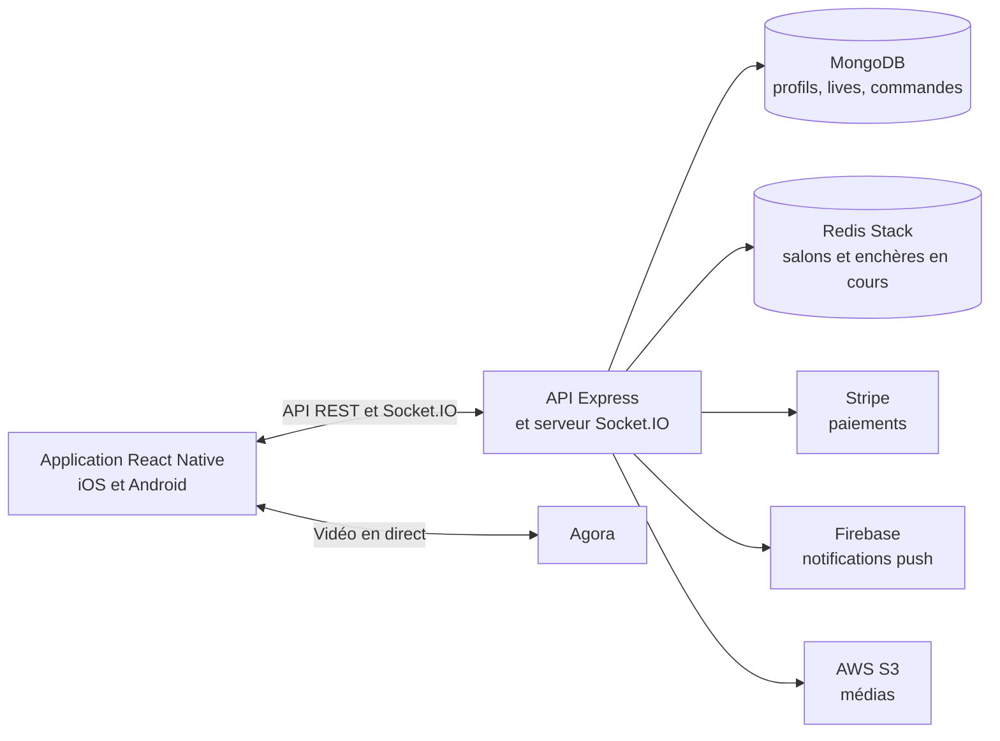

# LiveShopp

**Le shopping en direct, de la diffusion vidéo jusqu'à la commande.** LiveShopp réunit une application mobile iOS et Android et une API temps réel. Un vendeur peut préparer un live, présenter ses produits et lancer une enchère ; les acheteurs regardent, discutent, enchérissent et retrouvent leurs commandes dans l'application.

Ce dépôt contient les deux parties du produit : le client **React Native** et le serveur **Node.js / Express**. Il couvre des sujets concrets de développement mobile et backend : vidéo en direct, synchronisation temps réel, authentification, paiement, notifications et gestion des rôles.

## Ce que fait l'application

| Parcours | Fonctionnalités |
| --- | --- |
| Acheteur | Découvrir les lives, regarder la diffusion, participer au chat et aux enchères, gérer son profil et suivre ses commandes. |
| Vendeur | Créer et gérer ses lives, animer les enchères et suivre les commandes à expédier. |
| Administrateur | Accéder aux outils de modération des utilisateurs signalés ou bloqués. |

Lors d'un live, **Agora** transporte la vidéo. **Socket.IO** synchronise le chat, la présence et les enchères ; **Redis Stack / RedisJSON** conserve l'état des salons et des enchères en cours. Le serveur enregistre les données durables dans **MongoDB**, utilise **Stripe** pour le paiement et crée la commande à l'issue d'une vente. **Firebase Cloud Messaging** sert aux notifications push.

> **Périmètre actuel :** le parcours de vente en direct est au cœur de l'application. Le code des enchères vidéo hors live existe, mais son interface est actuellement masquée.

## Architecture



| Couche | Technologies principales |
| --- | --- |
| Mobile | React Native 0.74, React Navigation, Redux Toolkit, i18next (français et anglais) |
| API et temps réel | Node.js, Express, Socket.IO, JWT |
| Données | MongoDB / Mongoose, Redis Stack / RedisJSON |
| Services | Agora, Stripe, Firebase Cloud Messaging, AWS S3, Nodemailer, Sentry |
| Vérification | Jest pour le client et le serveur |

## Organisation du dépôt

```text
liveshopp/       Application React Native (écrans, navigation, état, services)
liveshopp_back/  API Express, événements Socket.IO, modèles et tests
appspec.yml      Configuration de déploiement du backend
```

Les guides propres à chaque partie se trouvent dans [le README mobile](liveshopp/README.md) et [le README backend](liveshopp_back/README.md).

## Démarrer en local

**Prérequis :** Node.js 18 ou plus, npm, un environnement de développement React Native pour iOS ou Android, MongoDB et Redis Stack (le module RedisJSON est utilisé). Pour exercer tous les parcours, il faut aussi configurer ses propres accès Agora, Stripe, Firebase, AWS et SMTP.

1. Installer les dépendances et créer les fichiers de configuration locaux :

   ```sh
   git clone https://github.com/ATLHS/liveshopp_app.git
   cd liveshopp_app

   cd liveshopp_back
   npm ci
   cp .env.sample .env

   cd ../liveshopp
   npm ci
   cp .env.sample .env
   ```

2. Renseigner les variables nécessaires dans les deux fichiers `.env`. Le [modèle mobile](liveshopp/.env.sample) contient notamment l'URL de l'API et les identifiants publics des services mobiles ; le [modèle backend](liveshopp_back/.env.sample) liste les connexions et secrets serveur. En développement, faire pointer `REACT_APP_LOCAL_URL` vers l'adresse du serveur accessible depuis le simulateur ou l'appareil, avec le port configuré par `PORT` côté backend. Les valeurs d'exemple ne suffisent pas à exécuter tous les services.

3. Démarrer Redis Stack, puis lancer le serveur et l'application dans des terminaux distincts :

   ```sh
   # Terminal 1 — depuis liveshopp_back/
   npm run dev

   # Terminal 2 — depuis liveshopp/
   npm start

   # Terminal 3 — depuis liveshopp/
   npm run android
   # ou : npm run ios (macOS, Xcode et CocoaPods requis)
   ```

Pour la préparation native d'iOS et d'Android, voir les instructions détaillées du [client mobile](liveshopp/README.md).

## Tests

Les tests Jest couvrent notamment le démarrage de session mobile, les contrôles d'accès API et Socket.IO, les enchères et les commandes.

```sh
(cd liveshopp && npm test -- --runInBand --watch=false)
(cd liveshopp_back && npm test -- --runInBand --watch=false)
```

Ces tests s'exécutent avec des dépendances simulées. La validation complète de la vidéo, des paiements et des notifications requiert les services externes et un appareil ou simulateur configuré.
