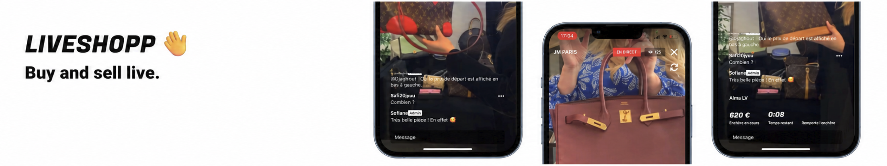
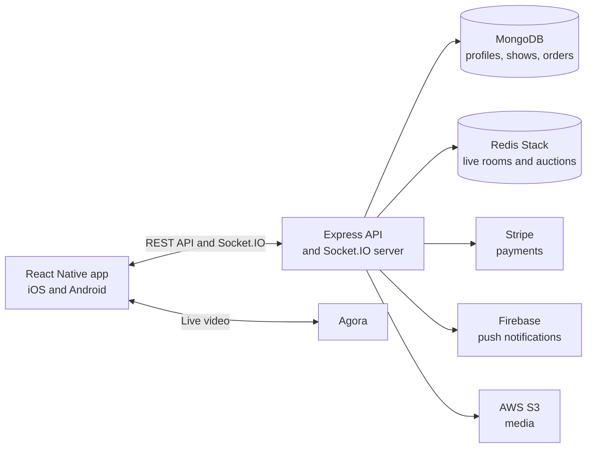

# Liveshopp

**Buy and sell live.** Liveshopp is a mobile live shopping marketplace for new and pre-owned items on iOS and Android. Sellers present products on video and run live auctions. Buyers watch, chat, bid, and track their orders.

[Liveshopp App Store](https://apps.apple.com/ci/app/liveshopp/id6448577391)



## What the app does

| Experience | What happens |
| --- | --- |
| Buyers | Discover live shows, watch sellers present products, chat, place bids, and follow their orders. |
| Sellers | Create and manage shows, host live auctions, and manage orders awaiting shipment. |
| Administrators | Review reported users and manage blocked accounts. |

A sale spans the mobile app and the backend. **Agora** carries the video stream. **Socket.IO** keeps chat, presence, bids, and auction state in sync. **Redis Stack / RedisJSON** holds active rooms. **MongoDB** stores profiles, shows, and orders. **Stripe** handles payments when an auction closes, and **Firebase Cloud Messaging** delivers push notifications.

> **Current scope:** the live selling flow is the focus of the app. Code for auctions on prerecorded videos exists, but its mobile interface is currently hidden.

## Architecture



| Area | Main technologies |
| --- | --- |
| Mobile | React Native 0.74, React Navigation, Redux Toolkit, i18next |
| API and real time | Node.js, Express, Socket.IO, JWT |
| Data | MongoDB / Mongoose, Redis Stack / RedisJSON |
| Integrations | Agora, Stripe, Firebase Cloud Messaging, AWS S3, Nodemailer, Sentry |
| Tests | Jest on both the mobile app and backend |

## Repository layout

```text
liveshopp/       React Native app: screens, navigation, state, and API clients
liveshopp_back/  Express API, Socket.IO handlers, models, and tests
appspec.yml      Backend deployment configuration
```

For platform-specific setup, see the [mobile guide](liveshopp/README.md) and [backend guide](liveshopp_back/README.md).

## Getting started

**Requirements:** Node.js 18+, npm, a React Native development environment for Android or iOS, MongoDB, and Redis Stack with RedisJSON. To run every product flow, configure your own Agora, Stripe, Firebase, AWS, and SMTP credentials.

1. Install dependencies and create local configuration files:

   ```sh
   git clone https://github.com/ATLHS/liveshopp_app.git
   cd liveshopp_app

   cd liveshopp_back
   npm ci
   cp .env.sample .env

   cd ../liveshopp
   npm ci
   cp .env.sample .env
   ```

2. Fill in the required variables in both `.env` files. The [mobile template](liveshopp/.env.sample) contains the API URL and public mobile identifiers. The [backend template](liveshopp_back/.env.sample) lists server connections and secrets. Set `REACT_APP_LOCAL_URL` to a backend address reachable from the simulator or device, using the backend's `PORT` value. The sample values alone cannot run every integration.

3. Start Redis Stack, then run the backend and mobile app in separate terminals:

   ```sh
   # Terminal 1 — from liveshopp_back/
   npm run dev

   # Terminal 2 — from liveshopp/
   npm start

   # Terminal 3 — from liveshopp/
   npm run android
   # or: npm run ios (requires macOS, Xcode, and CocoaPods)
   ```

## Tests

The Jest suites cover mobile session startup, API and Socket.IO authorization, auctions, and orders.

```sh
(cd liveshopp && npm test -- --runInBand --watch=false)
(cd liveshopp_back && npm test -- --runInBand --watch=false)
```

These tests use mocked dependencies. End-to-end validation of video, payments, and push notifications requires the external services and a configured device or simulator.
